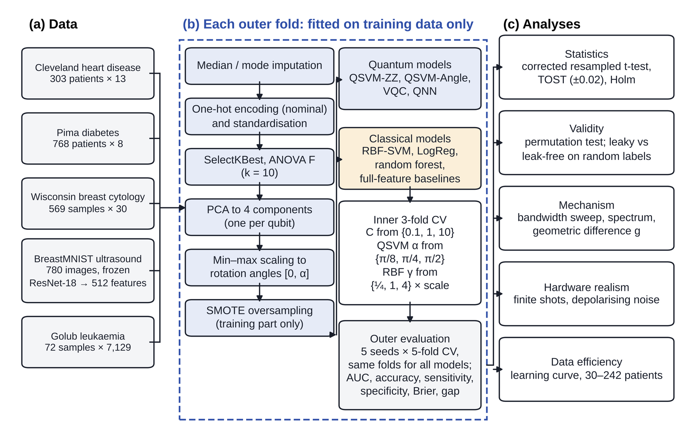
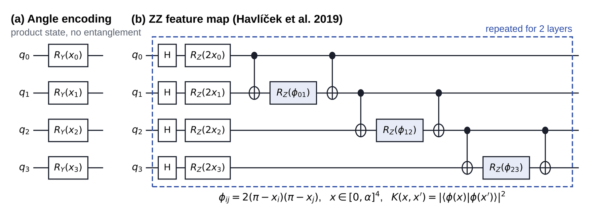
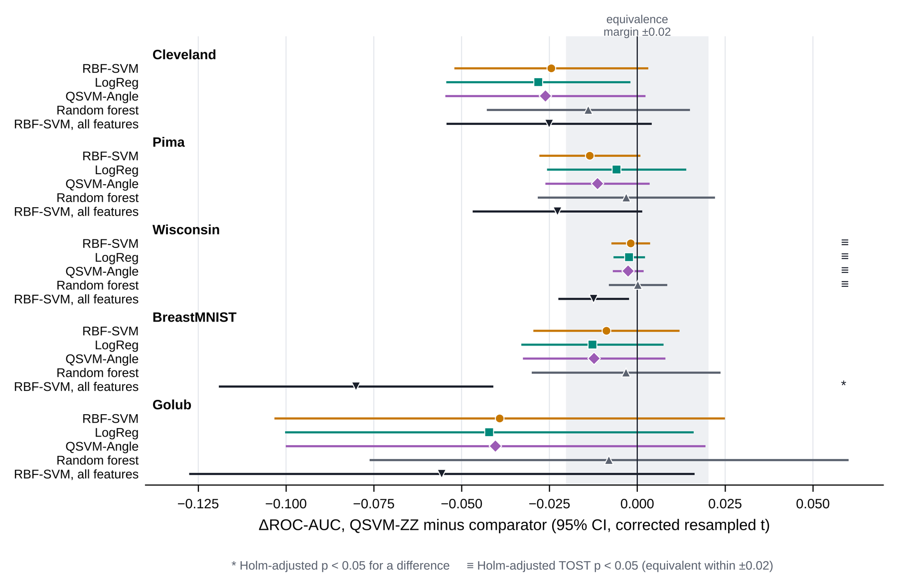
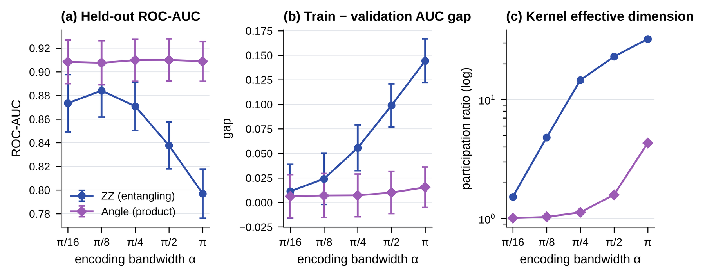
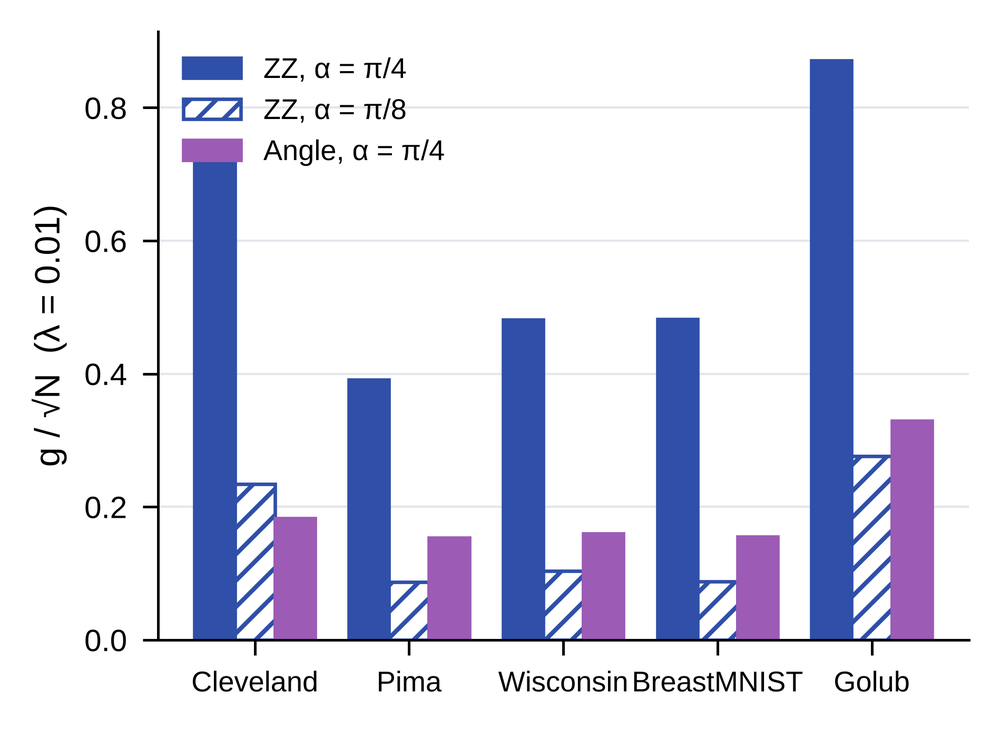
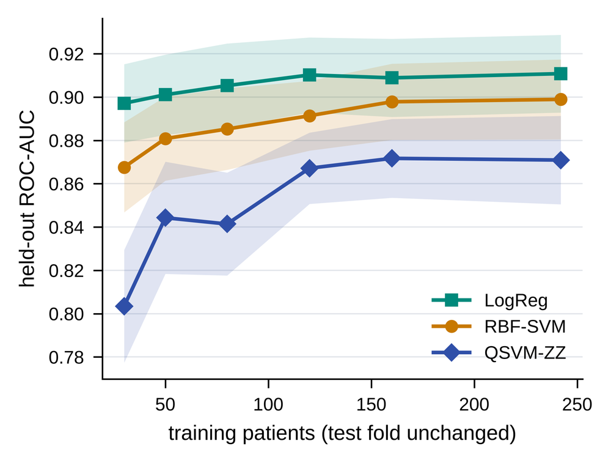
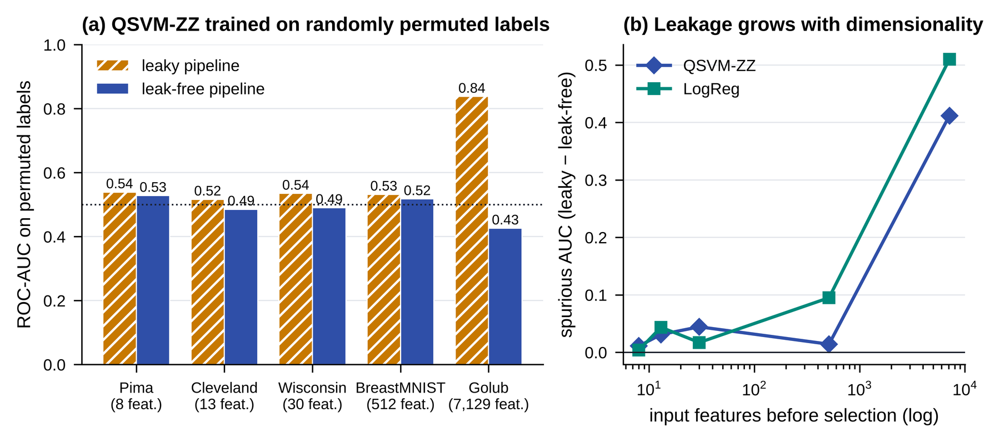
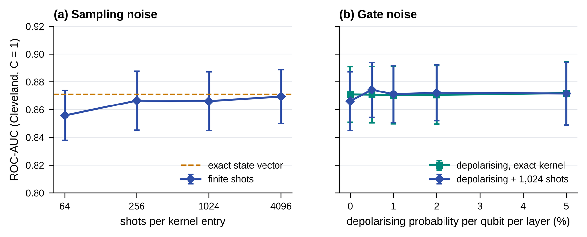

  

  
  
  
  
  
  
  

  <b>Problem Statement SIH26139</b> · Egreen Quanta · MedTech / BioTech / HealthTech · Team <b>Dark-47</b>

---

## Overview

**QMed** is a hybrid quantum–classical machine learning platform for early disease detection. It asks a simple question that is often skipped: *when quantum and classical models are compared fairly, does a quantum kernel actually help on real medical data?*

To answer it, QMed puts quantum kernel classifiers, a variational quantum classifier and a hybrid quantum neural network side by side with tuned classical models on **five medical datasets** — clinical tables, cytology, gene expression and breast ultrasound images. Every preprocessing step is fitted inside each training fold, every kernel gets the same tuning budget, and every comparison is backed by paired statistical tests over repeated cross-validation.

The result is an honest picture: on these datasets the entangling quantum kernel did not beat classical models, and the platform explains *why* — through encoding bandwidth, kernel spectrum and geometric difference — while showing how easily a leaky pipeline can manufacture results that look impressive.

## At a glance

| | |
|---|---|
| **Quantum models** | QSVM with ZZ feature map (entangling), QSVM with angle encoding (classical control), VQC, hybrid QNN |
| **Classical models** | RBF-SVM, logistic regression, random forest, and all-feature baselines |
| **Datasets** | Cleveland heart disease · Pima diabetes · Wisconsin breast cytology · BreastMNIST ultrasound · Golub leukaemia |
| **Qubits** | 4 (one per principal component) |
| **Protocol** | 5 seeds × stratified 5-fold CV, identical folds for every model, nested tuning of *C* and bandwidth |
| **Statistics** | Corrected resampled *t*-test, TOST equivalence test (±0.02 AUC), Holm correction, 200-permutation label test |
| **Stack** | PennyLane, scikit-learn, imbalanced-learn, PyTorch / torchvision, NumPy, pandas, Matplotlib |

## Key findings

- 🔍 **No quantum advantage under fair evaluation.** The entangling quantum kernel had the lower mean ROC-AUC in **31 of 32** paired comparisons; only one difference was statistically significant after correction (−0.080 against an RBF-SVM using all 512 image features).
- 📉 **Fewer patients made it worse, not better.** With 30 training patients the quantum kernel trailed logistic regression by **0.094** ROC-AUC (95% CI −0.110 to −0.077).
- 🎛️ **Bandwidth, not entanglement, drives behaviour.** Raising the encoding bandwidth increased the kernel's effective dimension from **1.5 to 32.4** and the train–validation gap from **0.011 to 0.144**. The ZZ kernel performed best exactly where it behaved most like a classical kernel.
- 🧭 **Different geometry is not the same as useful geometry.** The ZZ kernel's geometric difference from the RBF kernel reached *g*/√*N* = 0.87, yet the datasets where it differed most were the ones where it lost most.
- 🚨 **Leakage can fake a strong result.** Fitting feature selection and PCA on all data produced an ROC-AUC of **0.84 from completely random labels** on the 7,129-gene leukaemia data. The effect grows with the number of input features.
- 📡 **Robust to realistic noise.** 1,024 measurement shots cost only 0.005 ROC-AUC, and depolarising noise up to 5% had no measurable effect.

## How the platform works

  

1. **Data** — five public medical datasets. Ultrasound images are turned into 512 features by a frozen ImageNet-pretrained ResNet-18 that never sees the labels.
2. **Leak-free preprocessing** — imputation → one-hot encoding and standardisation → ANOVA *F* feature selection (*k* = 10) → PCA to 4 components → min–max scaling to rotation angles [0, α] → SMOTE. All of it is refitted inside the training part of every fold.
3. **Models** — quantum and classical models receive exactly the same four inputs.
4. **Nested tuning** — an inner 3-fold CV picks *C* ∈ {0.1, 1, 10} and the bandwidth (α ∈ {π/8, π/4, π/2} for quantum kernels, γ ∈ {¼, 1, 4} × default for RBF).
5. **Evaluation** — held-out ROC-AUC, accuracy, sensitivity, specificity, Brier score and train–validation gap, followed by paired statistical testing.
6. **Mechanism and validity** — bandwidth sweep, kernel spectrum, geometric difference, noise simulation, learning curves, permutation tests and a leakage demonstration.

### Quantum feature maps

  

The **angle encoding** applies one *RY* rotation per qubit and gives a product state whose kernel can be written in closed form — a built-in classical control. The **ZZ feature map** adds Hadamard layers and nearest-neighbour entangling blocks, repeated twice, and is the main quantum model. The fidelity kernel *K*(*x*, *x′*) = |⟨φ(*x*)|φ(*x′*)⟩|² feeds a support vector machine.

## Results

### Held-out ROC-AUC (mean ± SD over five seeds)

| Model | Cleveland | Pima | Wisconsin | BreastMNIST | Golub |
|---|:-:|:-:|:-:|:-:|:-:|
| **QSVM-ZZ** (quantum) | 0.883 ± 0.007 | 0.809 ± 0.004 | 0.983 ± 0.001 | 0.837 ± 0.011 | 0.942 ± 0.027 |
| QSVM-Angle (classical control) | 0.909 ± 0.007 | 0.820 ± 0.003 | 0.986 ± 0.001 | 0.849 ± 0.013 | 0.982 ± 0.007 |
| VQC | 0.889 ± 0.006 | – | – | – | – |
| QNN (hybrid) | 0.901 ± 0.007 | – | – | – | – |
| RBF-SVM | 0.907 ± 0.008 | 0.823 ± 0.001 | 0.985 ± 0.001 | 0.846 ± 0.015 | 0.981 ± 0.010 |
| Logistic regression | 0.911 ± 0.007 | 0.815 ± 0.002 | 0.986 ± 0.001 | 0.850 ± 0.012 | 0.984 ± 0.009 |
| Random forest | 0.897 ± 0.003 | 0.812 ± 0.006 | 0.983 ± 0.003 | 0.840 ± 0.011 | 0.950 ± 0.014 |
| RBF-SVM, all features | 0.908 ± 0.005 | 0.832 ± 0.006 | 0.996 ± 0.000 | 0.917 ± 0.008 | 0.998 ± 0.004 |

All models except the last row use the same four principal components per fold. VQC and QNN were evaluated on Cleveland.

### Paired comparisons

  

Each point is the mean of 25 paired fold-level differences, with confidence intervals from the corrected resampled *t*-test. The shaded band is the ±0.02 equivalence margin.

### Why the quantum kernel behaves this way

  

<table>
  <tr>
    <td width="50%"></td>
    <td width="50%"></td>
  </tr>
  <tr>
    <td align="center">Geometric difference from the RBF kernel</td>
    <td align="center">Learning curves with 30–242 training patients</td>
  </tr>
</table>

### Data leakage and noise

  

  

### Clinical interpretation

On the heart-disease data, the quantum kernel, the RBF-SVM and logistic regression agreed on the most influential clinical variables: **thallium stress-test result**, **number of major vessels** and **chest-pain type**. Permutation importance was computed on held-out folds and mapped back to the original clinical variables, not to principal components.

## Repository contents

| Notebook | What it contains |
|---|---|
| `QMed_V1.ipynb` | First version of the platform: data pipeline, quantum models, benchmark and explainability |
| `QMed_Journal.ipynb` | Full multi-dataset benchmark with statistical testing, validity checks and publication figures |
| `QMed_Journal_V2.ipynb` | Final benchmark with nested bandwidth tuning, revised validity criteria and the complete result package |

## Datasets

| Dataset | Samples | Features | Task |
|---|:-:|:-:|---|
| Cleveland heart disease | 303 | 13 | Coronary artery disease |
| Pima diabetes | 768 | 8 | Diabetes onset |
| Wisconsin diagnostic breast cancer | 569 | 30 | Malignant vs benign mass |
| BreastMNIST (ultrasound) | 780 images | 512 (CNN features) | Malignant vs benign lesion |
| Golub leukaemia | 72 | 7,129 genes | ALL vs AML |

All datasets are public (UCI Machine Learning Repository, OpenML and MedMNIST).

## Author

**Md. Abu Sayem** · Manav Rachna International Institute of Research and Studies, Faridabad, India

---

Built with PennyLane, scikit-learn and PyTorch · All figures are generated from the platform's own experimental results

